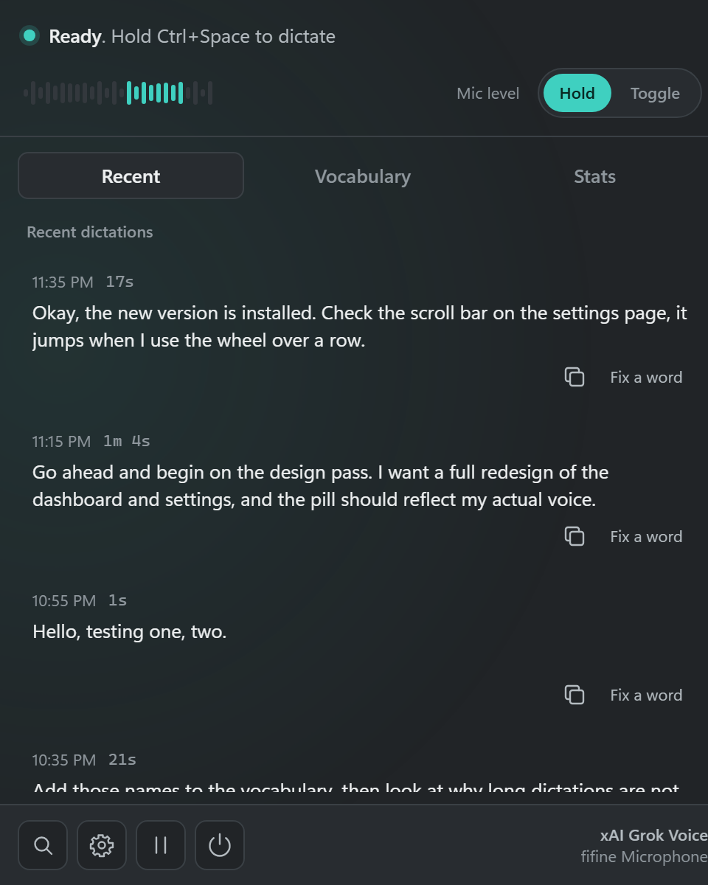
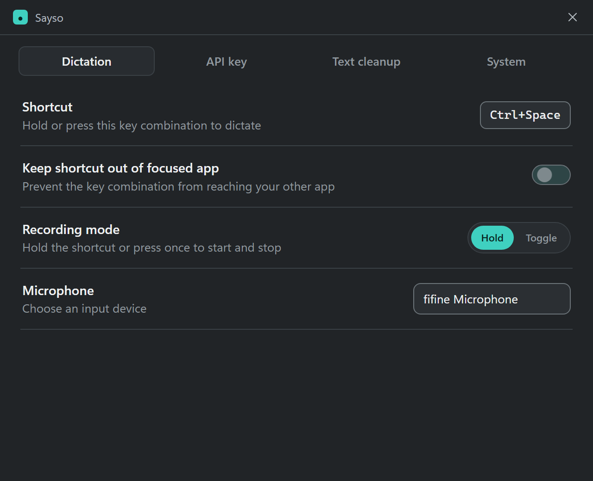

# Sayso

Push-to-talk voice dictation for Windows. Hold a key, talk, let go: the words
are typed into whatever window is in front. Bring your own xAI API key; there
is no account, no subscription and no server of ours in between.

It was built for one job: dictating long prompts into terminals and AI coding
agents without a model rewriting what was said. So it types exactly what the
recogniser heard (after light, rule-based clean-up you can switch off), it
learns the names and technical terms you use so they stop coming out wrong, and
it stays out of the way: about 4 MB of memory while idle, no window until you
open one.

<p align="center">
  
  
</p>

## What it does

- **Hold to talk.** Default shortcut `Ctrl+Space`; change it in Settings. A
  toggle mode (press to start, press to stop) is one click away in the tray.
- **Types, does not paste.** Text is typed with `SendInput`, paced so terminals
  and editors keep up, so it works in places where Ctrl+V does not (terminal
  panes, SSH sessions, agent CLIs). Multi-line text and very long dictations
  go through the clipboard, and the clipboard is restored afterwards.
- **A small pill, not a window.** A capsule near the bottom of the screen
  shows your voice level while you hold the key, a wave while the audio is
  transcribed, a check mark when the text has landed, and a short message if
  something failed. No words otherwise.
- **Tray flyout.** Click the tray icon for status, the last dictations, search
  over history, copy, "fix a word", pause and Settings. Settings has four
  tabs: Dictation, API key, Text cleanup, System.
- **Clean-up you can see.** A doubled word ("we'll we'll") is collapsed,
  fillers ("um", "uh") are removed, the first letter is capitalised, a
  dictionary fixes spellings you choose, and snippets expand a spoken trigger
  into saved text. Every step is a rule, never a language model, and every
  optional step has a switch.
- **Say "scratch that".** "Undo", "scratch that", "never mind" or "delete
  that" within 30 seconds removes the last dictation from the same window.
- **Code mode.** Spoken symbol names ("open paren", "equals") become symbols
  for dictating into code.
- **Names come out right.** Add terms to the vocabulary and they are sent with
  every request as recognition hints. With automatic vocabulary on, the app
  also learns terms from your project folder names and from its own mistakes
  (see below).
- **Light.** Idle: about 4 MB committed, 16 MB working set, 0% CPU. The web
  view for the flyout exists only while the flyout is open.

What it deliberately does not do: no rewriting of your words by a language
model, no local or offline recogniser, no telemetry, no update check, no
cloud account.

## Requirements

- Windows 10 or 11, 64-bit.
- An [xAI API key](https://console.x.ai/). Transcription uses
  `grok-voice-transcribe-2.0`; at xAI's current price an hour of speech costs
  about 10 cents. The key is yours and is billed to you.
- The Microsoft Edge WebView2 runtime for the flyout and Settings (already on
  every Windows 11 and most Windows 10 machines; dictation itself works
  without it).

## Install

1. Download `Sayso-Setup-<version>.exe` from the
   [Releases](../../releases) page.
2. Run it. The installer is not code-signed, so Windows SmartScreen shows
   "Windows protected your PC": click **More info**, then **Run anyway**. It
   installs for the current user only (no admin prompt) into
   `%LOCALAPPDATA%\Sayso`.
3. Start the app, click the tray icon, open **Settings > API key** and paste
   your xAI key. It is encrypted with Windows DPAPI and stored on your machine.
4. Put the cursor in any text field, hold `Ctrl+Space`, speak, release.

Silent install: `Sayso-Setup-<version>.exe /S [/AUTOSTART=1] [/NORUN=1]`.
Uninstalling removes the program and shortcuts and keeps your settings, key,
dictionary and history.

To build it yourself instead, see [docs/DEVELOPMENT.md](docs/DEVELOPMENT.md).

## Using it

**Dictating.** Hold the shortcut and speak. Holds shorter than 300 ms are
ignored (an accidental tap types nothing). A recording stops on its own after
10 minutes. The text is typed into the window that was in front when you
released the key; if you switched windows in between, it is kept in history
instead of being typed somewhere else.

**Pausing.** The tray menu and the flyout both have a pause. Pausing cancels a
recording in progress.

**Fixing a word.** When the recogniser spells something wrong, open the flyout,
find the dictation, choose "Fix a word" and type the correct spelling. From
then on that correction is applied to every dictation. For names and terms the
recogniser does not know at all, add them in the flyout's **Vocabulary** pane;
they are sent as hints with every request (up to 100 terms, 50 characters
each).

**Snippets.** A snippet maps a spoken trigger to saved text. The bundled
`config/snippets.json` has three examples; point `snippets_path` at your own
file to replace them.

**Automatic vocabulary** (Settings > Text cleanup, off by default). When on,
the app:

- harvests names from the folders listed in `workspace_folders` (one and two
  levels deep, only names that are not plain English words), skipping anything
  in `workspace_exclude`;
- keeps the last 30 recordings in a ring so a guess can be checked against the
  audio;
- once a day asks an xAI text model (`review_model`) to look at up to 200
  recent transcripts for likely mishearings of names and technical terms,
  then re-runs the kept recording with each proposed term as a hint and keeps
  the term only if the recogniser agrees;
- replaces a misheard form automatically only when it is not an English word
  and was verified twice. Real words are never replaced behind your back.

Terms the app added are tagged "auto" in the vocabulary list and can be
removed there.

## Privacy and data

Everything the app stores is in two folders:

| Folder | Files |
|---|---|
| `%APPDATA%\Sayso` | `config.json` (settings), `xai_key.enc` (your key, DPAPI-encrypted), `dictionary.json` (your corrections), `vocabulary.json`, `auto_dictionary.json`, `review_state.json` (automatic vocabulary) |
| `%LOCALAPPDATA%\Sayso` | `history.jsonl` (your dictations; off with `history_enabled: false`), `logs\sayso.log`, `captures\rust-last.wav` (the last recording), `captures\ring\` (the last 30, automatic vocabulary only) |

What leaves your machine:

- Each recording is sent to `https://api.x.ai/v1/stt` with your vocabulary
  terms as hints. That is the service doing the transcription; it is governed
  by xAI's terms, not ours.
- With automatic vocabulary on, the daily review sends up to 200 recent
  transcripts (at most 600 characters each) to xAI's chat completions
  endpoint. Turn automatic vocabulary off and nothing but audio is sent.
- Nothing else. No telemetry, no crash reports, no update check.

The log file never contains dictated text or your key, so it is safe to attach
to a bug report. The key is read in the Rust process only and never reaches the
web view. `XAI_API_KEY` in the environment takes precedence over the stored key.

## Configuration

Settings covers the common options. Everything lives in
`%APPDATA%\Sayso\config.json`; keys not shown in Settings are marked.

| Key | Default | Meaning |
|---|---|---|
| `hotkey` | `"Ctrl+Space"` | Push-to-talk shortcut. Needs a modifier, except bare `F1`..`F12`. Restart to apply. |
| `recording_mode` | `"hold"` | `"hold"` or `"toggle"`. |
| `suppress_hotkey` | `true` | Keep the shortcut from reaching the app in front. Restart to apply. |
| `mic_device` | `""` | Input device name; empty is the system default. Restart to apply. |
| `post_process` | `true` | Master switch for the clean-up pipeline. |
| `remove_fillers` | `true` | Drop "um", "uh" and friends. |
| `auto_capitalize` | `true` | Capitalise the first letter. |
| `trailing_space` | `true` | Type one space after the text. |
| `code_mode` | `false` | Spoken symbol names become symbols. |
| `clipboard_threshold` | `20000` | Characters above which the text is pasted instead of typed. |
| `restore_clipboard` | `true` | Put the previous clipboard back after a paste. |
| `history_enabled` | `true` | Keep `history.jsonl`. |
| `hot_words` | `[]` | Your vocabulary terms. |
| `dictionary_path` | `""` | Your corrections file; empty uses the bundled dictionary until the first "fix a word". |
| `snippets_path` | `""` | Your snippets file; empty uses the bundled examples. |
| `auto_vocabulary` | `false` | The automatic vocabulary described above. |
| `workspace_folders` | `[]` | Folders to harvest names from (config only). |
| `workspace_exclude` | `[]` | Folder names to skip while harvesting (config only). |
| `review_model` | `"grok-4.7"` | xAI text model for the daily review (config only). |
| `vad_threshold` | `0.3` | xAI's speech-probability gate, 0 to 1; the API default is 0.5, lower helps quiet speakers (config only). |

The file is rewritten atomically and a broken file is never overwritten; fix it
by hand or delete it to start over.

## How it works

One native process (Rust, Tauri v2) and no window until you ask for one.

```
low-level keyboard hook ─ press ─▶ cpal microphone capture ─▶ 16 kHz mono WAV
                        ─ release ▶ xAI speech-to-text (multipart POST, hints as keyterm fields)
                                   ▶ clean-up pipeline (snippets, guard, doubled words,
                                     fillers, capitalisation, dictionary, code mode)
                                   ▶ SendInput typing into the foreground window
```

| Module (`src-tauri/src`) | Role |
|---|---|
| `hotkey.rs` | `WH_KEYBOARD_LL` hook, modifier handling, lost-key-up recovery |
| `audio.rs` | Microphone capture, level metering for the pill |
| `stt.rs` | The `SttEngine` trait and the xAI implementation |
| `post/` | The clean-up steps, each its own file with tests |
| `inject.rs` | Paced Unicode typing, clipboard path, undo |
| `pill.rs` | The layered-window capsule, drawn with tiny-skia and GDI |
| `tray.rs`, `commands.rs` | Tray menu, flyout and Settings windows, the Tauri commands |
| `store.rs` | Settings, DPAPI key, history, atomic writes |
| `vocab.rs`, `review.rs`, `words.rs` | Vocabulary pool, folder harvest, daily review, English word check |

The flyout and Settings are React 19 + TypeScript (`ui/`), built with Vite and
embedded in the exe. The web side never receives the key or a file path.

## Roadmap

- **More speech-to-text providers.** Each is one file implementing
  `SttEngine` (`transcribe(wav, hints)`); the rest of the app is unchanged.
  Deepgram, ElevenLabs Scribe and OpenAI are the obvious candidates. Pull
  requests welcome, see `CONTRIBUTING.md`.
- **Streaming**, so text starts arriving before you let go of the key.
- No plans for macOS or Linux: the keyboard hook, typing and key storage are
  all Win32.

## Contributing

See [CONTRIBUTING.md](CONTRIBUTING.md). Build notes, the installer and the
Tauri command list are in [docs/DEVELOPMENT.md](docs/DEVELOPMENT.md).

## Licence

Apache License 2.0. See [LICENSE](LICENSE) and [NOTICE](NOTICE). If you fork or
redistribute it, keep the NOTICE file: that is the attribution the licence asks
for.

Created by [Kavish Singh](https://github.com/Straughz).
